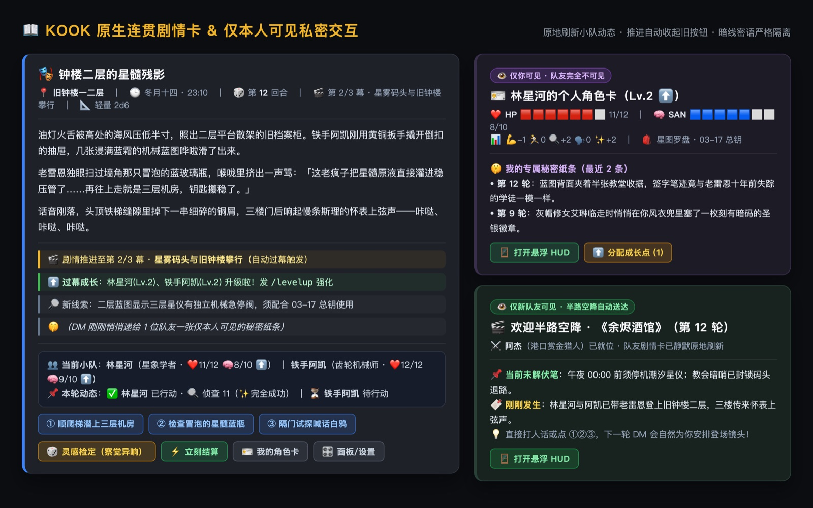
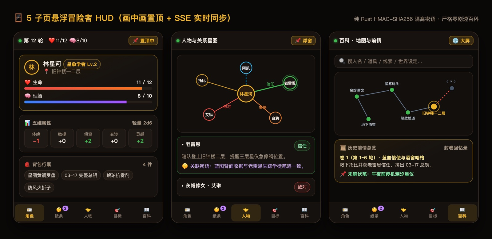

# 🍺 KOOK AI 群酒馆 · 多人实时 AI 跑团引擎 (`kook-tavern-dm`)

[](./LICENSE)
[](https://www.rust-lang.org/)
[](https://github.com/shu1yue/kook-tavern/actions)

> 面向 **1~6 人亲友实时团** 的原生群聊 AI TRPG / 群酒馆 DM 引擎：纯 Rust 单二进制零外部依赖（常驻仅 **~16 MB 内存**），内置 **KOOK 卡片原地刷新故事流**、**暗夜之刃式进度钟与反谜语/反水剧情四重铁闸**、**5 子页置顶悬浮角色卡 HUD（含 SVG 圆形钟盘）**、**4 层多人长剧本抗失忆引擎**、**多规则确定性检定（`2d6` / `D&D d20` / `CoC d100`）**、**SillyTavern 角色卡与世界书导入** 及 **内置 AI 剧本工坊**。
>
> *A lightweight, single-binary Rust multiplayer AI TRPG & Group Tavern DM engine for KOOK — featuring cohesive live story cards, Blades-in-the-Dark pacing clocks & real-time anti-riddle/anti-stall rewrite gates, a spoiler-safe floating player HUD (with Picture-in-Picture, SVG clock wheels & HMAC whisper isolation), a 4-layer long-campaign memory engine, deterministic dice/act progression, and SillyTavern card/lorebook import. Licensed under **GNU AGPL-3.0**.*

## 🖼️ 界面与交互一览

<p align="center">
  
</p>

<p align="center">
  
</p>

---

## ✨ 核心亮点

- **📖 像翻小说一样的 KOOK 原生故事流、独立包间与无剧透任务书（`v2.1.0` 新增）**
  - **🚪 动态独立跑团包间（`/table` / `/menu` 并排双按钮）**：点「🚪 开独立包间」自动在同一分组下秒建全新干净子频道并自动摆好开局卡，大厅发出可直达的蓝字传送门，彻底告别串桌旧记录；跑完两步确认一键「🗑️ 拆掉包间」（硬锁绝不误删人类频道，内置 6 桌上限与 30s 防刷屏冷却）；
  - **📜 无剧透桌前任务书 + `/story` 仅本人私密浮层**：开局卡与 Web 看板/悬浮 HUD 直接呈现世界舞台、任务书、公开人物与无剧透命运分歧预告；随时发 `/story` 或点面板简报仅自己可见，绝不刷屏队友；
  - **🧭 告别选择题按钮，回归真·自由 TRPG**：剧情卡只展示 2~3 条开放式 **「💡 眼下可切入焦点」**（不再用 ①②③ 按钮框死脑洞），搭配 DM **「事实由世界决定，行动由玩家决定」** 第一性裁决与 **⏸️ `/pause` 等人/自由飙戏暂停开关**，自由扮演更过瘾；
  - 推进新回合自动原地收起旧卡按钮（持久化在 SQLite 重启不丢），内置 KOOK `40011` 审核词自愈柔化，拒绝吞回合、不断档。
- **⏳ 反水剧情 & 反谜语人四重铁闸（`v2.0.0` 新增）**
  - **暗夜之刃式威胁钟 & 进度钟**：每套剧本自动配置红/绿双钟（内置本、工坊本与导入本全生效），威胁钟支持后端确定性定时自动走格，满格立即触发爆发横幅与下轮 DM 强制爆发指令，AI 想拖戏也拖不动；
  - **先定干货再写正文 + 防 AI 顺从症**：前置 `turn_outcome` 逼迫模型先敲定实质推进再展开描写，同时锁死剧本既定真相与凶手设定，不因讨好玩家脑洞而篡改案情；
  - **实时质检拦截与大白话重写**：在百炼 System One 单次语义质检中顺路检测“谜语人 / 水剧情”（叠加本地零延迟启发式兜底），一旦拦到打哑谜或原地灌水，发到 KOOK 前自动一键重写成现代大白话；
  - **终幕 Boss 防失踪**：进入最终幕自动注入终幕核心人物与结局世界书并静默无关街边号外，痛快收束结局。
- **🪟 5 子页个人实时悬浮 HUD（支持真·置顶画中画）**
  - 基于纯 Rust **HMAC-SHA256** 的个人只读凭证（结团 `/reset` 或离桌 `/leave` 自动失效），队友无法伪造偷看私密纸条；
  - 底部 5 格原生 App 导航：`🪪 角色`（血量/理智/五维/绝活/背包）、`🤫 纸条`（仅本人可见暗线密语 + 新纸条角标）、`🤝 人物`（交互式 SVG 人物关系星图，点头像交叉检索关联线索与密语）、`🎯 目标`（当前幕次主线 + **防剧透 SVG 圆形切片进度钟盘** + 推荐行动 + 线索墙）、`📖 百科`（全局秒搜 + 互动节点地图 + 严格零剧透 `player_visible` 常识词典 + 历史前情总览）；
  - HTTPS 下支持 Chrome/Edge **Document Picture-in-Picture 真·永远置顶浮窗**，边开麦边挂在 KOOK 旁边。
- **🧠 4 层多人长剧本抗失忆引擎**
  1. **动态章节回忆录（Append-Only 永不覆写）**：借鉴 SillyTavern Memory Books，每满 6 轮封存 1 张带关键词的不可变章节卷，杜绝“传话筒式越压越糊”；
  2. **Letta 式契约与未解伏笔便签**：每次封卷独立维护当前未完成承诺、倒计时与悬念；
  3. **仅 DM 可见的暗线密语总账**：DM 牢记之前私发给不同队友的暗线底牌，多人长团不串戏、不公屏泄密；
  4. **线索智能打捞**：常驻最新 25 条线索，并按本轮行动/地点/人名滑窗召回早期相关物证。
- **🎬 半路空降无缝接团**
  - 朋友在开打后（`turn >= 1`）随时点选职业 / `/join` / `/char load` 空降进桌，系统会自动私发一份 **「🎬 欢迎半路空降 · 前情速递」**（含当前未解伏笔、近期封卷、刚刚发生的剧情、队友与一键悬浮 HUD 链接），同时 DM 会在下一轮自然把新队友写进镜头里。
- **🎲 后端确定性规则、自动转幕与成长体系**
  - 原生支持 **`2d6`（轻量三档）**、**`D&D d20`（优势/劣势、熟练加值、激励点、队友 `/assist` 协助、短休/长休、充能招牌技）** 与 **`d100`（克苏鲁风）**；
  - 后端按地图节点（`enter_nodes`）确定性兜底转幕，彻底告别大模型忘记转幕的问题：`2d6`/`d20` 过幕自动触发全队 **Lv.+1 与 `/levelup` 成长点**，`d100` 调查模式则改为符合克系基调的 **「阶段领悟 / SAN 喘息」**；
  - 跨团个人角色库（`/char`）支持公平购点车卡与换本复用。
- **🛠️ 开源世界书商店 + AI 剧本工坊 + SillyTavern 导入**
  - 内置 6 套可复用的开放世界观底座（`worldbooks/`），支持群内 `/workshop` 引导式锻造新剧本，以及通过 `/gm import` 直接导入 **SillyTavern PNG 角色卡 / JSON 世界书**（内置 HTTPS 白名单 SSRF 防护与防 Zip Bomb 校验）。
- **💰 极致轻量与低成本**
  - 实测 2C2G Linux 服务器常驻内存仅 **~16 MB**；搭配 DeepSeek（开启前缀缓存优化），一场 26 轮完整跑团实测仅花费约 **¥0.40 RMB**，内置每日调用次数 & 金额双熔断与 `/cost` 实时账单。
  - 可选接入 **System One（Jev 潜意识反射层）** 做群聊 OOC 过滤、隐藏世界书语义召回与防泄密语义质检（不填 Key 则零开销关闭）。

---

## 📚 内置剧本与开源世界书

### 4 套开箱即用剧本（`scenarios/`）
| 剧本 ID | 名称 | 题材与特色 | 默认规则 |
|---|---|---|---|
| `ember_tavern` | **余烬酒馆与迷雾委托** | 蒸汽海港奇幻悬疑（3 幕 · 多结局） | `2d6` |
| `fog_manor` | **雨夜黑杉庄园** | 1926 暴风雪山庄哥特推理 / 轻量克系（3 幕） | `2d6` / 推荐 `d100` |
| `midnight_metro` | **午夜四号线 · 末班车怪谈** | 现代中式都市规则怪谈 / 微恐解谜（3 幕） | `2d6` |
| `sunforge_keep` | **剑湾晨钟 · 失落铸炉** | 经典 D&D 五幕中篇战役（含 4 职业招牌技） | `D&D d20` |

### 6 套内置开源世界书底座（`worldbooks/`）
`srd_sword_coast_fantasy`（剑湾奇幻）、`lovecraft_arkham_1920s`（1920s 阿卡姆调查）、`campus_rules_horror`（校园规则怪谈）、`cyber_kowloon_2099`（赛博九龙城）、`eastern_wuxia_jianghu`（国风武侠江湖）、`starship_frontier_colony`（星舰边疆殖民地）。

---

## 🚀 快速开始（3 种方式任选）

### 方式 1：本地零成本体验（无需 API Key，离线 Mock DM）
```bash
git clone https://github.com/shu1yue/kook-tavern.git
cd kook-tavern
cargo run -- local --mock-llm
```
> 在终端模拟器里可直接体验建卡、行动、掷骰、回档、多角色切换（`@角色名`）。

### 方式 2：Docker Compose 一键自部署（推荐）
```bash
git clone https://github.com/shu1yue/kook-tavern.git
cd kook-tavern
cp .env.example .env
# 编辑 .env，至少填入 KOOK_BOT_TOKEN 与 LLM_API_KEY
# 建议同时用 `openssl rand -hex 32` 生成一个 HUD_SIGNING_SECRET
docker compose up -d --build
```
服务启动后访问 `http://127.0.0.1:8787/healthz` 看到 `"status":"ok"` 即成功！
如需启用**浏览器原生置顶画中画悬浮 HUD**，建议在前面套一层 **Cloudflare Tunnel** 或 Nginx/Caddy HTTPS 反向代理，并将公网 HTTPS 地址填入 `.env` 的 `WEB_PUBLIC_BASE_URL`。

### 方式 3：预编译单二进制直跑（Linux x86_64，免装 Rust · 2C2G 小鸡友好）
直接从 **[GitHub Releases](https://github.com/shu1yue/kook-tavern/releases/latest)** 下载最新版 `kook-tavern-dm-vX.Y.Z-linux-x86_64.tar.gz` 解压即用：
```bash
tar -xzf kook-tavern-dm-v2.1.0-linux-x86_64.tar.gz
cd kook-tavern-dm-v2.1.0-linux-x86_64
cp .env.example .env
# 编辑 .env 填入 KOOK_BOT_TOKEN、LLM_API_KEY、ALLOWED_GUILD_IDS、ADMIN_USER_IDS
./kook-tavern-dm kook
```
如需从源码自行编译（要求 `rustc >= 1.88`）：`CARGO_BUILD_JOBS=1 cargo build --release --locked -p kook-tavern-dm`。
完整 `systemd` 托管、防断档原子更新与 SQLite 每日自动热备模板详见 [DEPLOY_ECS.example.md](./DEPLOY_ECS.example.md)。

---

## 🎮 常用指令速查

| 分类 | 指令（均支持中文别名） | 说明 |
|---|---|---|
| **开团与包间** | `/menu` `/table <剧本ID>` `/tables` `/start <剧本ID>` `/roles` | 秒开独立干净包间 / 本频道开团 / 选职业入桌 |
| **推进与飙戏** | 直接打字 / `/act <行动>` / `/pause` / `/go` / `/undo` | 自由扮演、暂停自动结算自由飙戏、立刻结算、回档 |
| **检定与战斗** | `/check <属性>` `/roll 1d20` `/skill` `/assist <队友>` | 属性检定、自由掷骰、放招牌技、协助队友享优势 |
| **休整与成长** | `/短休`（`/rest short`） `/长休`（`/rest long`） `/levelup` | 恢复 HP/SAN/技能充能、按钮一键分配五维/血量升级 |
| **面板与浮窗** | `/story` `/me` `/hud` `/web` `/status` `/closetable` | 私密无剧透任务书、角色卡、悬浮 HUD、全队大屏与拆包间 |
| **创作与管理** | `/store` `/workshop` `/char` `/gm` `/export` `/reset` | 世界书商店、AI 工坊、跨团角色库、战报导出与结团 |

---

## 🧱 架构总览（8-Crate 六边形分层）

```text
kook-tavern/
├── crates/
│   ├── domain/          # 纯领域模型、进度钟引擎、反谜语/水剧情检测、骰子 RNG 与确定性 Patch（零 IO、零 unsafe）
│   ├── core/            # 抽象端口 Trait、显式 Collecting⇄Resolving 状态机、HMAC 浮窗令牌与命令/简报编排
│   ├── infra-sqlite/    # SQLite WAL 存储、14 步版本号增量迁移、托管包间台账、CAS 事务回档与 SillyTavern 导入
│   ├── infra-llm/       # OpenAI 兼容传输层、4 层记忆本引擎、3 阶段 JSON 自愈解析、可选 Jev 决策与重写门
│   ├── adapter-kook/    # KOOK v3 WebSocket、原地刷新活卡、频道级串行锁、40011 审核柔化与私密降级
│   ├── adapter-web/     # Axum 嵌入式只读大屏 + 5 子页个人悬浮 HUD + SSE 实时推送 + 代理感知限流
│   ├── adapter-cli/     # 本地多人终端模拟器
│   └── app/             # 主二进制入口与全链路集成测试套件
├── prompts/             # 外置热加载 DM/摘要/文风提示词（改完即生效，免重编译）
├── scenarios/           # 内置 4 套 YAML 剧本（支持 player_visible 防剧透拆分与 enter_nodes 自动转幕）
├── worldbooks/          # 内置 6 套开放世界书底座
├── Dockerfile           # 多阶段非 root 生产镜像
├── docker-compose.yml   # 一键自部署编排
└── DEPLOY_ECS.example.md
```

---

## 💡 关于开发方式

本项目是**个人独立企划 + AI 辅助开发（Vibe Coding）**的实践产物：
- **人负责的部分**：全部产品构思、跑团玩法取舍、真实群聊数十轮实战测试、踩坑排障与质量验收；
- **AI 负责的部分**：在明确架构约束下辅助完成 Rust 代码编写、重构与自动化测试补全。

虽然不是传统意义上的“纯手敲”，但项目坚持**真机实战驱动**（含 74 项自动化回归测试、CI 严格 Clippy 零告警及单文件 ≤ 350 行门禁），已稳定运行在个人服务器上。非常欢迎懂 Rust 或爱跑团的朋友随时提 Issue、Code Review 或发 PR 一起玩！

---

## 🛡️ 本地开发与质检门禁

```bash
cargo clippy --workspace --all-targets -- -D warnings
cargo test --workspace
```
本项目坚持严格的工程卫生规范：所有生产 `.rs` 源码文件均保持 **`<= 350` 行**、零 `unsafe`、零 Clippy 告警，详情见 [REVIEW_CHECKLIST.md](./REVIEW_CHECKLIST.md) 与 [CONTRIBUTING.md](./CONTRIBUTING.md)。

---

## 📜 开源协议（GNU AGPL-3.0）

本项目基于 **[GNU Affero General Public License v3.0 (AGPL-3.0)](./LICENSE)** 开源：
- 欢迎个人与亲友团自由下载、自部署、魔改剧本与二次开发；
- 如果你修改了本项目代码并**部署上线向他人提供网络服务（包括但不限于公开跑团 Bot 或 Web 服务）**，请遵循 AGPL-3.0 第 13 条，将你修改后的完整源代码同样以 AGPL-3.0 协议公开。
- 详见 [LICENSE](./LICENSE) 与 [CHANGELOG.md](./CHANGELOG.md)。
